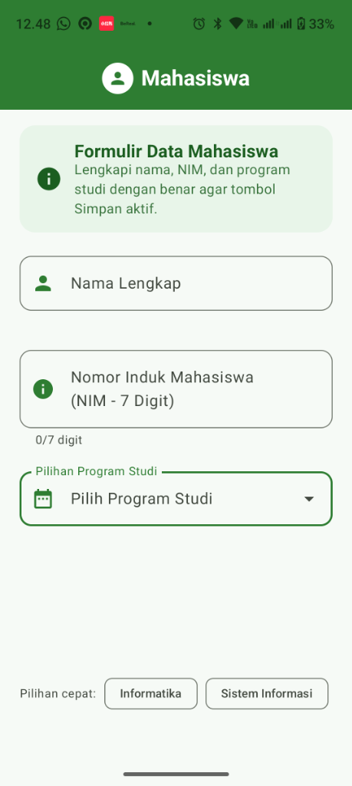
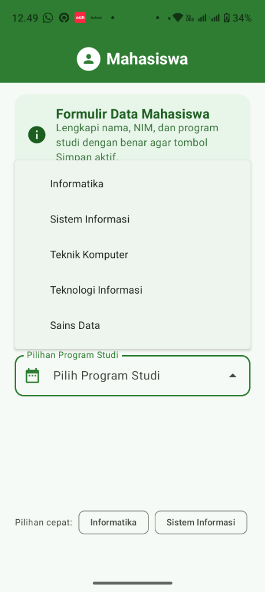
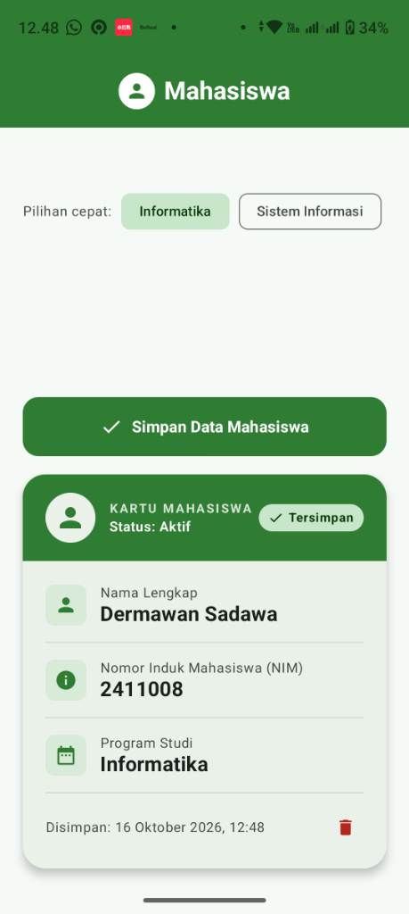

# Aplikasi Mahasiswa - Jetpack Compose (Tema Hijau)

Aplikasi Android berbasis **Kotlin** dan **Jetpack Compose (Material Design 3)** yang dibuat untuk memenuhi tugas mata kuliah **Pemrograman Aplikasi Bergerak (PAB)**.

---

### 👤 Identitas Mahasiswa
- **Nama Lengkap**: Dermawan Sadawa
- **NIM**: 2411008
- **Program Studi**: S1 Informatika
- **Mata Kuliah**: Pemrograman Aplikasi Bergerak (PAB)

---

## 📸 Dokumentasi & Tangkapan Layar (Screenshots)

Berikut adalah tampilan antarmuka aplikasi **Mahasiswa** yang berjalan langsung pada perangkat Android:

| 1. Formulir Input & Validasi | 2. Menu Pilihan Program Studi | 3. Kartu Mahasiswa Tersimpan |
|:---:|:---:|:---:|
|  |  |  |
| *Form input dengan indikator 0/7 digit NIM dan tombol cepat* | *Menu dropdown pilihan prodi (Informatika, dll.)* | *Tombol aktif & Kartu Mahasiswa elegan setelah disimpan* |

---

## 📝 Refleksi Singkat Praktikum

Dalam pengerjaan aplikasi **Mahasiswa** menggunakan Jetpack Compose ini, terdapat beberapa refleksi teknis dan pemahaman penting yang diperoleh:

1. **Pergeseran Paradigma dari Imperatif (XML) ke Deklaratif (Jetpack Compose)**:  
   Pada arsitektur Android tradisional (XML Views), pengembang harus mengelola status UI secara manual menggunakan `findViewById`, `setText`, dan event listener yang rawan inkonsistensi (*state desynchronization*). Dengan Jetpack Compose, UI didefinisikan sebagai fungsi dari state (`UI = f(State)`). Ketika state seperti `namaInput`, `nimInput`, atau `prodiInput` diperbarui, Compose secara efisien hanya merekomposisi komponen yang terpengaruh.

2. **Validasi Input Real-Time dan *Feedback* Pengguna yang Ramah**:  
   Penerapan validasi reaktif memastikan tombol **Simpan Data Mahasiswa** hanya aktif (`enabled = isFormValid`) saat semua kriteria terpenuhi:
   - Nama minimal 3 karakter alfabet tanpa angka.
   - NIM tepat 7 digit angka (didukung pembatasan input dan indikator `x/7 digit`).
   - Program Studi sudah dipilih.  
   Penggunaan `supportingText` dengan pesan error kontekstual memberikan *instant feedback* kepada pengguna tanpa menampilkan pesan error agresif saat form pertama kali dimuat.

3. **Efisiensi Interaksi dengan Komponen Material 3 Modern**:  
   Integrasi `ExposedDropdownMenuBox` yang dipadukan dengan *Quick FilterChip* untuk opsi **Informatika** dan **Sistem Informasi** terbukti memangkas jumlah interaksi (klik). Pengguna dapat memilih program studi dalam 1 kali ketukan cepat atau membuka daftar lengkap melalui dropdown.

4. **Ketahanan State (*State Persistence*) & Notifikasi Non-Intrusif**:  
   Penggunaan `rememberSaveable` memastikan data input dan kartu profil yang sudah tersimpan tidak hilang saat perangkat mengalami perubahan konfigurasi (seperti rotasi layar). Selain itu, penggunaan `SnackbarHost` berbasis Kotlin Coroutine (`coroutineScope.launch`) menyajikan notifikasi keberhasilan yang informatif tanpa memblokir alur kerja antarmuka pengguna.

---

## 🚀 Fitur Utama Aplikasi

| No | Fitur | Penjelasan & Implementasi Teknis |
|---|---|---|
| 1 | **Formulir Input Teks** | Menggunakan `OutlinedTextField` untuk Nama, NIM, dan Program Studi dengan ikon representatif dan tombol pembersih teks (*clear button*). |
| 2 | **Validasi Panjang NIM (7 Digit)** | Membatasi input angka maksimal 7 digit, dilengkapi penghitung panjang digit (*counter*) dan validasi tepat 7 digit. |
| 3 | **Pilihan Program Studi** | Menu dropdown Material 3 (`ExposedDropdownMenu`) dengan pilihan utama **Informatika**, serta *FilterChip* untuk pemilihan cepat. |
| 4 | **Tombol Simpan Dinamis** | Properti `enabled = isFormValid` mengaktifkan tombol hanya jika seluruh data telah valid secara serentak. |
| 5 | **Kartu Mahasiswa (*Profile Card*)** | Komponen `ElevatedCard` bertema hijau dengan animasi masuk (`AnimatedVisibility`), badge status *Tersimpan*, waktu simpan, dan tombol hapus data. |
| 6 | **Notifikasi Snackbar** | Menampilkan umpan balik visual popup hijau di bagian bawah layar saat data berhasil disimpan atau dihapus. |
| 7 | **Tema Hijau Material 3** | Palet warna *Forest & Emerald Green* (`#2E7D32`) dengan `dynamicColor = false` agar konsisten di semua versi Android. |

---

## 📂 Struktur Proyek

```text
profil_mahasiswa_compose/
├── app/
│   ├── build.gradle.kts
│   └── src/main/
│       ├── AndroidManifest.xml
│       ├── java/com/example/profilmahasiswa/
│       │   ├── MainActivity.kt               # Logika Form, Validasi, Dropdown, Snackbar, & Kartu Mahasiswa
│       │   └── ui/theme/
│       │       ├── Color.kt                  # Definisi palet warna bertema Hijau
│       │       ├── Theme.kt                  # Konfigurasi Tema Material 3
│       │       └── Type.kt                   # Tipografi teks
│       └── res/values/
│           ├── strings.xml                   # Nama aplikasi ("Mahasiswa")
│           └── themes.xml
├── screenshots/                              # Dokumentasi tangkapan layar aplikasi
│   ├── 1_form_input.png
│   ├── 2_dropdown_prodi.png
│   └── 3_kartu_profil_mahasiswa.png
├── Mahasiswa.apk                             # Berkas installer APK siap pasang
├── build.gradle.kts
└── settings.gradle.kts
```

---

## 📲 Unduh & Pasang APK Langsung

Berkas APK hasil kompilasi siap dipasang langsung ke perangkat Android:
👉 **[Unduh Mahasiswa.apk](Mahasiswa.apk)**
*(Mendukung Android 7.0 Nougat / API 24 hingga Android 14 / API 34)*

---

## 💻 Cara Menjalankan di Android Studio

1. Buka **Android Studio**.
2. Pilih menu **File** > **Open...** lalu arahkan ke folder repositori ini.
3. Tunggu hingga proses **Gradle Sync** selesai.
4. Hubungkan perangkat Android fisik atau jalankan Android Emulator.
5. Klik tombol **Run ('app')** atau tekan shortcut `Shift + F10`.
